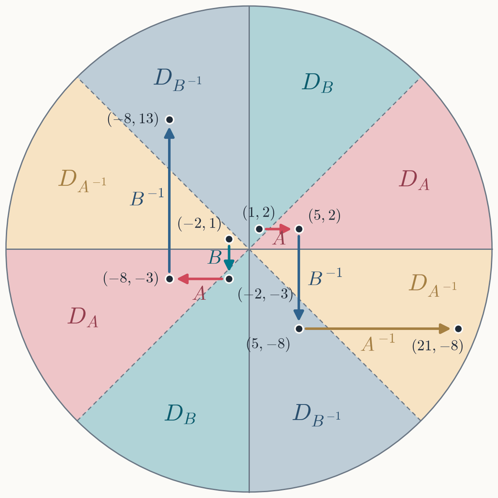

# Examples

Classic places where ping-pong proves a group is free, one place where it can't, and the theorem that makes ping-pong central to linear groups.

## Sanov's matrices

[[thm:sanov]] (Sanov, 1947)
The matrices $A = \mat1201$ and $B = \mat1021$ generate a free group of rank $2$.

[[prf:sanov]]
Let $X = \{(x, y) : \abs x > \abs y\}$ and $Y = \{(x, y) : \abs y > \abs x\}$ in $\R^2$. For $n \ne 0$, $A^n(x, y) = (x + 2ny, y)$. If $(x, y) \in Y$, then $\abs{x + 2ny} \ge 2\abs n \abs y - \abs x > \abs y$, so $A^n(Y) \subseteq X$. Swapping the coordinates gives $B^n(X) \subseteq Y$. The cones are nonempty and disjoint, and $\gen A$ is infinite, so the two-set form in [[notes/The ping-pong lemma]] applies.

The four-set form works too, once each cone is split by the sign of $xy$:

| Set | Where | Over $\Z$ |
| --- | --- | --- |
| $D_A$ | $\abs x > \abs y$, $xy > 0$ | $x > y > 0$ or $x < y < 0$ |
| $D_{A^{-1}}$ | $\abs x > \abs y$, $xy < 0$ | $x > -y > 0$ or $x < -y < 0$ |
| $D_B$ | $\abs y > \abs x$, $xy > 0$ | $y > x > 0$ or $y < x < 0$ |
| $D_{B^{-1}}$ | $\abs y > \abs x$, $xy < 0$ | $y > -x > 0$ or $y < -x < 0$ |

Each containment $s(D_t) \subseteq D_s$ with $t \ne s^{-1}$ is a short list of linear inequalities over $\Z$. Lean checks every one with `omega` in [[lean/PingPong/Sanov.lean]], and [[computations/count_reduced_words.py]] tests them on random points.

## Brenner's family

[[def:family]] (The family $G_t$)
For a number $t$, let $A_t = \mat1t01$, $B_t = \mat10t1$ and $G_t = \gen{A_t, B_t}$. Sanov's group is $G_2$.

[[thm:brenner]] (Brenner, 1955)
If $\abs t \ge 2$, then $G_t$ is free of rank $2$.

The proof is Sanov's, word for word: for $(x, y) \in Y$ and $n \ne 0$, $\abs{x + nty} \ge \abs t \abs y - \abs x > \abs y$.

[[ex:sl2z]] ($t = 1$ is not free)
$G_1 = \SL_2(\Z)$, and $A_1 B_1^{-1} A_1 = \mat01{-1}0$. Its square is $-I$, so $(A_1 B_1^{-1} A_1)^4 = I$. Written out, this is a reduced word of length $12$ that equals the identity.

[[rem:between]] (Between $1$ and $2$)
For $1 < \abs t < 2$ the cone argument breaks down near the diagonal: $A_t$ no longer pushes all of $Y$ into $X$. Set $t$ below $2$ in [[computations/ping_pong.py]] to see points where it fails. A failed proof is not a failed theorem, as the next remark shows.

[[rem:transcendental]] (Transcendental $t$)
Suppose a nonempty reduced word $w$ had $w(A_t, B_t) = I$ for a transcendental number $t$. Each entry of $w(A_x, B_x) - I$ is a polynomial in $x$ with integer coefficients that vanishes at $t$, so it is identically zero. Then $w(A_2, B_2) = I$, which contradicts Sanov's theorem. So $G_t$ is free for every transcendental $t$, however small.

## Schottky groups

Take four discs in the Riemann sphere with disjoint closures, and Möbius maps $a$, $b$ such that $a$ sends the outside of $D_{a^{-1}}$ onto the inside of $D_a$, and $b$ does the same for $D_{b^{-1}}$ and $D_b$. Ping-pong on the four discs shows that $a$ and $b$ freely generate a free group. The nested image discs shrink to the limit set, a Cantor set. The picture is in [[notes/The ping-pong lemma]], and you can drag the discs in [[apps/ping-pong-explorer]].

## The Tits alternative

[[thm:tits]] (Tits, 1972)
A finitely generated linear group either contains a free subgroup of rank $2$ or has a solvable subgroup of finite index.

The free subgroup comes from ping-pong. Tits finds two elements that, over a suitable local field, each have a single dominant eigenvalue. High powers of such a *proximal* element squeeze almost all of projective space toward one point, and pull it away from one hyperplane. Choosing the attracting points and repelling hyperplanes in general position gives four sets for the ping-pong lemma. The paper ([[manuscript/main.tex]]) sketches this, and Bibliography has Tits's paper with reading notes.
