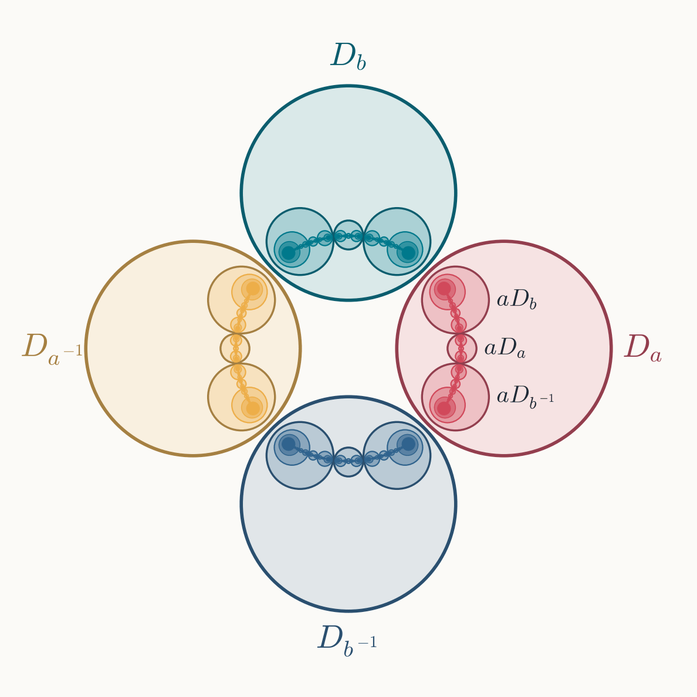

# The ping-pong lemma

A group acting on a set can sometimes be recognized as free just by watching where a few of its elements send a few subsets. Think of a ball bouncing between tables: once it lands on a table, the next player can only send it to another table, never back where it started.

## Reduced words

[[def:reduced]] (Reduced words)
Let $S = \{a, a^{-1}, b, b^{-1}\}$. A word $s_1 s_2 \cdots s_n$ in $S$ is *reduced* if $s_{k+1} \ne s_k^{-1}$ for every $k$.

There are $4 \cdot 3^{n-1}$ reduced words of length $n \ge 1$: four choices for the first letter, then three for each next one. Two elements $a, b$ of a group generate a free group of rank $2$, freely, exactly when no nonempty reduced word in them equals $1$.

## The four-set form

[[thm:pingpong]] (Ping-pong lemma)
Let a group $G$ act on a set $X$, and let $a, b \in G$. Suppose $D_a, D_{a^{-1}}, D_b, D_{b^{-1}} \subseteq X$ are nonempty and pairwise disjoint, and
$$s(D_t) \subseteq D_s \quad \text{for all } s, t \in S \text{ with } t \ne s^{-1}.$$
Then $a$ and $b$ freely generate a free group of rank $2$.

[[prf:pingpong]]
Let $w = s_1 s_2 \cdots s_n$ be a nonempty reduced word. Because $S$ has four letters, we can choose $t \in S$ with $t \ne s_1$ and $t \ne s_n^{-1}$, and a point $x \in D_t$. Since $t \ne s_n^{-1}$, the last letter sends $x$ into $D_{s_n}$. Since $w$ is reduced, $s_{k+1} \ne s_k^{-1}$, so $s_k$ maps $D_{s_{k+1}}$ into $D_{s_k}$. By induction, $w x \in D_{s_1}$. But $x \in D_t$ and $D_t \cap D_{s_1} = \emptyset$, so $w x \ne x$. Hence $w \ne 1$ in $G$.

The picture is a Schottky group: $a$ maps the outside of $D_{a^{-1}}$ onto the inside of $D_a$, and $b$ does the same for $D_{b^{-1}}$ and $D_b$. Each nested disc is the image of a disc under a reduced word, colored by the word's first letter. Drag the discs yourself in [[apps/ping-pong-explorer]].

[[rem:nonempty]] (Nonempty matters)
If the sets could be empty, the hypotheses would hold for any $a$ and $b$: take every $D_s = \emptyset$. The proof uses nonemptiness exactly once, to pick $x \in D_t$. An earlier draft of this note left the word out; open History to compare the two versions.

[[rem:schottky]] (The Schottky hypothesis)
Many books assume the stronger condition $s(X \setminus D_{s^{-1}}) \subseteq D_s$, which implies ours. Sanov's example in [[notes/Examples]] satisfies only the weaker one: $A\,(1, 0) = (1, 0)$ lies in none of the four sets.

The four-set form is proved in Lean in [[lean/PingPong/Lemma.lean]], with no `sorry`. There, "freely generate" becomes: no nonempty reduced word acts as the identity map of $X$.

## The two-set form

The same idea works for free products, with two sets instead of four.

[[thm:twoset]] (Ping-pong for free products)
Let $H_1, H_2$ be subgroups of $G$ with $\abs{H_1} \ge 3$ and $\abs{H_2} \ge 2$, acting on $X$. Suppose $X_1, X_2 \subseteq X$ are nonempty and disjoint, with $h(X_2) \subseteq X_1$ for every $h \in H_1 \setminus \{1\}$ and $h(X_1) \subseteq X_2$ for every $h \in H_2 \setminus \{1\}$. Then $\gen{H_1, H_2} \cong H_1 * H_2$.

[[prf:twoset]]
A nontrivial element of $H_1 * H_2$ is an alternating word $w$ in $H_1 \setminus \{1\}$ and $H_2 \setminus \{1\}$. If $w$ begins and ends with letters of $H_1$, then $w(X_2) \subseteq X_1$, and since $X_2 \ne \emptyset$ and $X_1 \cap X_2 = \emptyset$, $w \ne 1$. Every other word becomes one of these after conjugating by some $h \in H_1 \setminus \{1\}$. If $w$ begins and ends in $H_2$, any such $h$ works. If $w$ begins with $h_1 \in H_1$ and ends in $H_2$, take $h \ne h_1^{-1}$, so that $h w h^{-1}$ begins with $h h_1 \ne 1$. If $w$ begins in $H_2$ and ends with $h_m \in H_1$, take $h \ne h_m$. These last two choices need a third element of $H_1$, which is why we assumed $\abs{H_1} \ge 3$. Since a conjugate of $w$ is not $1$, neither is $w$.

[[ex:sanov]] (Sanov)
With $H_1 = \gen{A}$, $H_2 = \gen{B}$ for Sanov's matrices and the cones $X_1 = \{\abs x > \abs y\}$, $X_2 = \{\abs y > \abs x\}$, the two-set form shows $\gen{A, B}$ is free. Details in [[notes/Examples]].

## Where to go next

- Examples and a non-example: [[notes/Examples]].
- What ping-pong can't decide: [[notes/Open questions]].
- The same material as a paper: [[manuscript/main.tex]].
